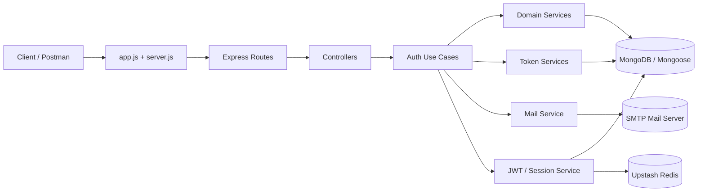

# Backend Auth Service

An Express-based authentication API focused on account registration, email activation, login, protected-session checks, logout, and password reset flows. The codebase is organized around controllers, use cases, and service adapters so the request layer stays thin and the business logic remains isolated.

## Architecture Overview

The project is built as a layered Node.js backend:



### Tech Stack

- Node.js with Express 5
- MongoDB with Mongoose
- JSON Web Tokens for access/session tokens
- Joi for request validation
- Nodemailer for activation and reset emails
- Multer and Sharp for avatar upload processing
- Helmet, CORS, Morgan, and cookie-parser for middleware support
- Upstash Redis for rate-limiting storage

## Codebase Breakdown

| Path                       | Purpose                                                                                          |
| -------------------------- | ------------------------------------------------------------------------------------------------ |
| `app.js`                   | Creates the Express app, applies global middleware, mounts routes, and registers error handling. |
| `server.js`                | Boots the HTTP server and connects to MongoDB before listening.                                  |
| `config/`                  | Environment, database, mail, CORS, Helmet, Morgan, Redis, and rate-limit configuration.          |
| `constants/`               | Shared message and code maps for success responses, errors, and mail types.                      |
| `controllers/auth/`        | Thin HTTP controllers for register, login, activation, logout, and password reset flows.         |
| `errors/`                  | Custom error class and centralized error handler.                                                |
| `middlewares/`             | Upload, validation, authentication, not-found, and rate-limit middleware.                        |
| `models/`                  | Mongoose models for `User`, `Session`, `ActivationToken`, and `ResetToken`.                      |
| `routes/`                  | Route definitions for auth and protected advanced routes.                                        |
| `services/auth.service.js` | Higher-level auth helpers and orchestration utilities.                                           |
| `services/domain/`         | Mongoose access helpers for user records.                                                        |
| `services/JWT/`            | Session creation, lookup, and logout helpers.                                                    |
| `services/mail/`           | Email transport and HTML templates for activation and reset emails.                              |
| `services/token/`          | Token persistence helpers for activation and reset flows.                                        |
| `useCases/auth/`           | Business logic for login, register, activate, reset password, resend flows, and logout.          |
| `utils/`                   | JWT, password, token, and extraction helpers.                                                    |
| `validators/auth/`         | Joi schemas for request validation.                                                              |
| `uploads/`                 | Local storage for processed avatar files.                                                        |
| `sockets/`                 | Reserved for realtime features; no socket route is currently mounted in `app.js`.                |

## Feature Set

- User registration with Joi validation and disposable-email blocking.
- Optional avatar upload on registration with image format checks and Sharp metadata stripping.
- Email activation token generation and activation-link delivery.
- Login with password comparison, session creation, and JWT access token issuance.
- Protected route guard that validates bearer tokens and reissues access tokens when needed.
- Logout from the current session or from all sessions.
- Forgot-password and resend-reset-email flows with short-lived reset tokens.
- Password reset using a 6-character code and a new password.
- Global and auth-specific rate limiting backed by Upstash Redis.
- Centralized error handling with a JSON `{ message }` response shape.

## Setup & Installation

### 1) Clone the repository

```bash
git clone <your-repo-url>
cd backend
```

### 2) Install dependencies

```bash
npm install
```

### 3) Create your environment file

Copy the sample file and fill in the values for your local environment.

```bash
copy .env.example .env
```

If you are using PowerShell, the equivalent command is:

```powershell
Copy-Item .env.example .env
```

### 4) Configure external services

- Start a MongoDB instance and set `MONGO_URI`.
- Create an Upstash Redis database and set the Redis REST URL and token.
- Configure an SMTP account for mail delivery.
- Ensure `CLIENT_URL` matches the frontend origin you want to allow through CORS.

### 5) Run the server

Development mode:

```bash
npm run dev
```

Production mode:

```bash
npm start
```

### Available scripts

| Script   | Command                                     | Purpose                                             |
| -------- | ------------------------------------------- | --------------------------------------------------- |
| `dev`    | `nodemon server.js`                         | Start the API in development mode with auto-reload. |
| `start`  | `node server.js`                            | Start the API without auto-reload.                  |
| `lint`   | `eslint .`                                  | Run ESLint across the project.                      |
| `format` | `prettier --write .`                        | Format the codebase with Prettier.                  |
| `test`   | `echo "Error: no test specified" && exit 1` | Placeholder test script.                            |

## Environment Variables

The sample environment file is [`/.env.example`](.env.example). The code reads the following values:

| Variable                   | Used By                                        | Purpose                                           |
| -------------------------- | ---------------------------------------------- | ------------------------------------------------- |
| `NODE_ENV`                 | `config/db.config.js`                          | Switches Mongoose auto-indexing behavior.         |
| `APP_URL`                  | Auth use cases                                 | Builds activation links for emails.               |
| `SERVER_PORT`              | `server.js`                                    | Port used by the HTTP server.                     |
| `CLIENT_URL`               | `config/cors.config.js`                        | Allowed frontend origin for CORS.                 |
| `MONGO_URI`                | `config/db.config.js`                          | MongoDB connection string.                        |
| `UPSTASH_REDIS_REST_URL`   | `config/redis.config.js`                       | Redis REST endpoint used by the rate-limit store. |
| `UPSTASH_REDIS_REST_TOKEN` | `config/redis.config.js`                       | Redis REST auth token.                            |
| `MAIL_HOST`                | `config/mail.config.js`                        | SMTP host.                                        |
| `MAIL_PORT`                | `config/mail.config.js`                        | SMTP port.                                        |
| `MAIL_SECURE`              | `config/mail.config.js`                        | Enables secure SMTP transport when set to `true`. |
| `MAIL_USER`                | `config/mail.config.js`                        | SMTP username.                                    |
| `MAIL_PASS`                | `config/mail.config.js`                        | SMTP password or app password.                    |
| `MAIL_FROM`                | `config/mail.config.js`                        | Default sender address.                           |
| `JWT_SECRET`               | JWT utilities                                  | Secret used to sign and verify JWTs.              |
| `JWT_EXPIRES`              | Auth/session use cases                         | Access-token lifetime used when issuing JWTs.     |
| `JWT_RESEND_EXPIRES`       | Password-reset use cases                       | Lifetime for the resend/reset helper token.       |
| `ACTIVATION_TOKEN_EXPIRES` | Activation use cases                           | Lifetime for activation tokens.                   |
| `RESET_TOKEN_EXPIRES`      | Password-reset use cases                       | Lifetime for reset tokens.                        |
| `LENGTH_ACTIVATION_TOKEN`  | `utils/generateRandomToken.utils.js` consumers | Length of activation codes.                       |
| `LENGTH_RESET_TOKEN`       | `utils/generateRandomToken.utils.js` consumers | Length of reset codes.                            |

## API Endpoint Documentation

### Base paths

- Public auth routes: `/api/v1/auth`
- Protected demo route: `/api/v1/adv`

### Authentication header

Protected endpoints read the JWT from:

```http
Authorization: Bearer <access-token>
```

### Standard response shape

Success and error responses are JSON objects. Most errors return:

```json
{
  "message": "Human-readable message"
}
```

### Public auth routes

| Method | Path                                  | Body / Params                                                                                          | Purpose                                                 | Typical Success Response                                                                                                                           |
| ------ | ------------------------------------- | ------------------------------------------------------------------------------------------------------ | ------------------------------------------------------- | -------------------------------------------------------------------------------------------------------------------------------------------------- |
| `GET`  | `/api/v1/auth/ping`                   | None                                                                                                   | Health check for the auth service.                      | `{ "success": true, "message": "auth service up" }`                                                                                                |
| `POST` | `/api/v1/auth/register`               | `multipart/form-data` with `username`, `firstName`, `lastName`, `email`, `password`, optional `avatar` | Creates a new user and sends an activation email.       | `201` with `{ "message": "Registration completed successfully! Please check your inbox to activate your account." }`                               |
| `GET`  | `/api/v1/auth/activate/:token`        | `token` in URL params                                                                                  | Activates a user account using the emailed token.       | `200` with an activation success message.                                                                                                          |
| `POST` | `/api/v1/auth/resend-activate`        | `{ "email": "user@example.com" }`                                                                      | Sends a new activation email.                           | `201` with a resend success message.                                                                                                               |
| `POST` | `/api/v1/auth/login`                  | `{ "email": "user@example.com", "password": "YourPassword123!" }`                                      | Authenticates the user and starts a session.            | `201` with `{ "message": "Welcome back! You have logged in successfully.", "token": { "accessToken": "..." } }`                                    |
| `GET`  | `/api/v1/auth/logout`                 | Bearer token required                                                                                  | Logs out the current session.                           | `201` with a logout success message.                                                                                                               |
| `GET`  | `/api/v1/auth/logoutFromAll`          | Bearer token required                                                                                  | Logs out the user from all sessions.                    | `201` with a logout success message.                                                                                                               |
| `POST` | `/api/v1/auth/forget-password`        | `{ "email": "user@example.com" }`                                                                      | Starts the password-reset flow and emails a short code. | `201` with `{ "message": "A password reset link has been sent to your email. Please check your inbox.", "rawToken": "...", "resendToken": "..." }` |
| `GET`  | `/api/v1/auth/resend-forget-password` | Bearer token required                                                                                  | Sends a new password-reset code.                        | `201` with `{ "message": "The password reset link has been resent successfully. Please check your inbox.", "code": { "rawToken": "..." } }`        |
| `POST` | `/api/v1/auth/reset-password`         | `{ "code": "123456", "newPassword": "NewPassword123!" }`                                               | Resets the password using the emailed code.             | `201` with a password-reset success message.                                                                                                       |

### Protected demo route

| Method | Path               | Purpose                                                           | Response                                                                                              |
| ------ | ------------------ | ----------------------------------------------------------------- | ----------------------------------------------------------------------------------------------------- |
| `GET`  | `/api/v1/adv/test` | Example protected endpoint that runs through the auth middleware. | `{ "success": true, "message": "ok next", "accessToken": "...", "userId": "...", "oldToken": "..." }` |

### Example requests

#### Register

```bash
POST /api/v1/auth/register
Content-Type: multipart/form-data

username=janedoe
firstName=Jane
lastName=Doe
email=jane@example.com
password=StrongPass123!
avatar=<file>
```

#### Login

```bash
POST /api/v1/auth/login
Content-Type: application/json

{
  "email": "jane@example.com",
  "password": "StrongPass123!"
}
```

#### Protected request

```bash
GET /api/v1/adv/test
Authorization: Bearer <access-token>
```

## Notes on the Current Implementation

- The auth flow is session-backed through the `Session` model and JWTs.
- Activation and reset links are sent through email templates in `services/mail/templates/`.
- Uploaded avatars are stored locally in `uploads/` after being processed with Sharp.
- The codebase already includes separate validators, services, and use cases for keeping the auth logic organized.
